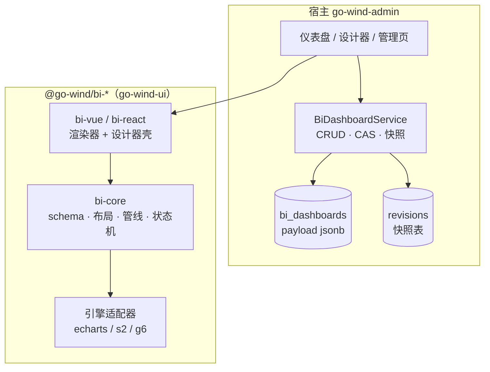

# GoWind Admin 拆解：BI 大屏设计器——可序列化 schema、resolver 取数与版本快照

> 本文回答一个问题：**把可视化设计器接进中后台时，schema 如何同时约束设计器与渲染器、取数如何不焊死在图表组件里、整份覆盖保存又怎样避免互相踩踏？**

BI 模块的产品形态可以压缩成一句话：一块可拖拽的仪表盘/大屏、一份描述它的 JSON，以及围绕这份 JSON 的存取与版本管理。真正难的不是把 ECharts 画出来，而是三条边界：

- **schema 与运行时**：JSON 里不能有函数，取数与事件必须从外部注入；
- **内核与宿主**：图型、布局、主题、撤销栈归组件库，持久化、权限、租户归中后台；
- **保存与并发**：整份覆盖保存天然会互相踩踏，版本号与快照要把这条路收窄。

下面按「边界 → schema → 数据 → 渲染 → 设计器 → 持久化 → 三端接入 → 失败模式」的顺序拆。

## 一、边界：payload 是黑盒，宿主只负责存取

架构上分两层：`@go-wind/bi-*` 负责「图怎么画、怎么改」，go-wind-admin 负责「图存在哪、谁能改、改了几版」。



这个边界在 ent schema 上就是一条 `payload` 列：

```go
// backend/app/admin/service/internal/data/ent/schema/bi_dashboard.go
field.String("payload").
    Comment("仪表盘 JSON（设计器 schema：数据集 + 图表布局 + 主题；服务端不解析只透传）").
    SchemaType(map[string]string{
        dialect.MySQL:    "json",
        dialect.Postgres: "jsonb",
    }),
```

「不解析」是刻意的：schema 的版本演进发生在库内（`schemaVersion` + 迁移器），后端只当字符串存取。这样前端升级图型字段、增加联动声明、调整主题结构，都不需要同步改后端或做数据库迁移；代价是**服务端失去对内容的结构约束**，所有校验必须在库与宿主保存钩子里完成。

`kind` 把同一套内核复用到三种产物：`DASHBOARD`（管理页内嵌）、`SCREEN`（投屏大屏）、`TEMPLATE`（可复用模板）。三者共享 schema 与渲染器，只在宿主侧决定入口和版式语义——分叉的是产品形态，不是内核。

`chart_count` / `theme_key` 是给列表页的读优化列：列表不解析 JSON 就能显示「几张图、什么主题」。代价是写路径要维护一致性，三端保存时都从 schema 现算：

```ts
// 三端保存钩子的共同口径
chartCount: schema.charts?.length ?? 0,
themeKey: schema.theme?.key ?? "",
```

只要有一个客户端漏传，冗余列就会漂移。它们不是数据库触发器算出来的，而是**宿主保存契约的一部分**——这一点在接入文档里必须写死，否则列表页会逐渐显示过期元数据。

## 二、schema：可序列化是硬约束，布局数学只写一份

Schema 的核心结构很小：

```ts
// packages/bi-core/src/schema/types.ts（节选）
export interface BiDashboardSchema {
  schemaVersion: 2;
  name: string;
  grid?: Partial<BiGridConfig>;   // 12 列 × 80px 行高 × 8px gap
  datasets: BiDatasetSchema[];
  charts: BiChartSchema[];
  linkage?: { enabled?: boolean };
  theme?: { key?: string };       // 空 = 跟随宿主亮暗
}
```

`charts` 里每个图表的坐标、图型、编码、聚合、排序、过滤器、下钻路径全是普通 JSON 字段：

```ts
interface BiChartSchema {
  id: string;
  title?: string;
  datasetId: string;
  engine?: string;               // 默认 "echarts"
  type: string;                  // bar/line/pie/... + 适配器注册的扩展图型
  x?: number; y?: number; w?: number; h?: number;
  encoding: {
    dimension?: string;          // 类目轴 / 饼名
    measure?: string;            // 单度量
    measures?: string[];         // 宽表多度量（优先级最高）
    series?: string;             // 长表系列拆分
  };
  aggregation?: "sum" | "avg" | "count" | "max" | "min" | "none";
  sort?: { by: "dimension" | "measure"; order: "asc" | "desc"; topN?: number };
  filters?: Array<{ field: string; op: string; value: unknown }>;
  style?: Record<string, unknown>;
  drill?: { path: string[] };
  options?: Record<string, unknown>;  // 引擎原生透传覆盖
}
```

**可序列化是硬约束**：schema 里不允许出现函数。图表点击、取数、跳转这些运行时行为全部走注入的回调，而不是塞进 JSON。这条约束同时买到四件事——可落库、可 diff、可迁移、可导出成模板文件。任何「为了方便把 formatter 函数写进 schema」的捷径，都会在第一次跨端保存或导入导出时反噬。

`schemaVersion` 是迁移链的锚点。`migrateSchema` 逐级升版，未知版本直接抛错（fail-fast，不吞）；v1→v2 只是补版本号，因为 v2 新增字段全部可选。`normalizeSchema` 在入口补默认值（grid、图表宽高、encoding），这带来一个后面会反复出现的副作用：**规范化后的 JSON 与服务端原文永远不会字符串相等**。

布局数学只写一份，设计器画布和渲染器共用：

```ts
// packages/bi-core/src/schema/layout.ts（节选）
const grid = defaultGrid(gridInput);
const placed = flowPlace(charts, grid.columns);
const colWidth = containerWidth > 0 ? containerWidth / grid.columns : 0;
const half = grid.gap / 2;

const items = placed.map((chart) => {
  const x = chart.x ?? 0;
  const y = chart.y ?? 0;
  const w = chart.w ?? CHART_DEFAULT_SIZE.w;
  const h = chart.h ?? CHART_DEFAULT_SIZE.h;
  return {
    chart, x, y, w, h,
    left: x * colWidth + half,
    top: y * grid.rowHeight + half,
    width: w * colWidth - grid.gap,
    height: h * grid.rowHeight - grid.gap,
  };
});
```

`flowPlace` 负责流式放置：已经带 `x/y` 的图表保留原坐标，缺失的逐行扫描第一块放得下的空位。设计器拖拽时写回的是栅格坐标，渲染器读到的也是同一套 `layoutCharts`——**「设计器里拖出来的」和「渲染器里看到的」是同一份数学**，不会出现设计态与运行态各算一套像素的问题。

没有引入 GridStack 之类现成栅格库，原因也在这里：它们通常直接改 DOM，与 Vue/React 的 vdom 更新冲突；而 12 列绝对定位 + 指针事件把手的组合足够覆盖仪表盘场景，且没有额外依赖。


## 三、数据链路：resolver 是宿主的插座，transform 是内核的管线

数据集分两类：`static` 内嵌行，`api` 声明式占位。真实取数不在渲染器里，而在宿主注入的 resolver 表里：

```ts
// packages/bi-core/src/dataset/index.ts
export type BiDatasetResolver = (
  dataset: BiDatasetSchema,
  params: Record<string, unknown> | undefined
) => Promise<BiRow[]>;
```

对应的解析逻辑很短，但语义很关键：

```ts
// packages/bi-core/src/dataset/index.ts（节选）
if (dataset.type === "static") {
  return { rows: dataset.rows ?? [], loading: false, error: null };
}
if (!resolver) {
  return {
    rows: [],
    loading: false,
    error: `[bi] dataset "${dataset.name}" (${dataset.id}) is type "api" but no resolver was provided`,
  };
}
try {
  const rows = await resolver(dataset, dataset.api?.params);
  return { rows: Array.isArray(rows) ? rows : [], loading: false, error: null };
} catch (err) {
  // 原始错误必须留在控制台：用户可见文案不携带原因（不吞错铁律）
  console.error(`[bi] dataset "${dataset.name}" resolver failed`, err);
  return { rows: [], loading: false, error: err instanceof Error ? err.message : String(err) };
}
```

两个设计取向值得记下来：

1. **没接 resolver 是显式错误，不是静默空图**。api 数据集没有注入取数函数时，卡片进入 error 状态并给出 dataset 名；否则用户只会看到一张空图表，排查方向会从「数据没接」歪到「图表配置错了」。
2. **错误不静默**。原始错误进控制台，卡片上出现 error 角标（完整原因挂在 tooltip），不会退化成一张看起来正常的空图。

宿主侧只需要把函数表挂到 env 上：

```ts
// Vue
provideBiEnv({
  resolvers: {
    ds_orders: (dataset, params) => api.listOrders(params),
  },
});

// React
<BiProvider env={{ resolvers }}>
  <BiDashboard schema={schema} />
</BiProvider>
```

渲染器不持有任何 HTTP 客户端。换 REST、gRPC、另一个服务的聚合接口，改的都是宿主注入的这一层，图表组件零改动。这也是 schema 能保持纯 JSON 的前提：**数据来源是运行时依赖，不是 schema 的一部分**。

拿到行之后，内核跑一条固定管线：

```ts
// packages/bi-core/src/dataset/transform.ts
export function transformRows(chart: BiChartSchema, inputRows: BiRow[]): BiRow[] {
  let rows = applyFilters(inputRows, chart.filters);
  if (shouldAggregate(chart)) {
    rows = aggregateRows(rows, chart);
  }
  rows = sortRows(rows, chart);
  return rows;
}
```

顺序是**过滤 → 聚合 → 排序/TopN**，设计器画布与渲染器共用。几个容易踩的细节：

- `aggregation` 缺省是 `sum`，设成 `"none"` 才关闭聚合；
- `sankey` / `graph` / `heatmap` 这类边列表、矩阵型图表天然按行消费，`NON_AGG_TYPES` 会跳过聚合；
- 宽表多度量（`measures`）与长表系列拆分（`series`）互斥，`measures` 优先；`pivot` 的列维度会在聚合时保留，供 S2 交叉表使用；
- 数值统一走 `toNumber`，非有限数归 0——图表轴不允许 `NaN`/`undefined`；
- 图表级 `filters` 与跨图联动共用 `applyFilters`，联动只是把「点击值 = 某字段」这条过滤条件追加到数据集行上。

## 四、渲染链路：三个方法接一个引擎，主题在编译期落进 option

图表引擎的抽象只有三个方法：

```ts
// packages/bi-core/src/engine/types.ts
export interface ChartEngine {
  /** 挂载容器并渲染首帧（option 由 compile 产出） */
  mount(el: HTMLElement, option: unknown): ChartHandle;
  /** schema + 行数据 + 主题 → 引擎原生 option */
  compile(chart: BiChartSchema, rows: BiRow[], theme: BiResolvedTheme): unknown;
  /** 订阅归一化点击事件 */
  bindEvents(handle: ChartHandle, cb: (e: BiChartEvent) => void): void;
}

export interface ChartHandle {
  update(option: unknown): void;
  resize(): void;
  dispose(): void;
  getDataURL?(): string | undefined;   // 导出 PNG 用，引擎不支持可不实现
}
```

主题在**编译期**写进 option，引擎层不负责主题切换——换主题就是重新 `compile` + `update`。这样 ECharts、S2、G6 各适配器不需要各自实现一套主题监听，亮暗切换只有一条路径。

图型通过注册表映射到引擎：

```ts
// packages/bi-core/src/engine/chart-types.ts（节选）
const typeToEngine = new Map<string, string>();
for (const t of BUILTIN_CHART_TYPES) typeToEngine.set(t, "echarts");

export function registerChartType(type: string, engine: string): void {
  typeToEngine.set(type, engine);
}
```

内置 13 种 ECharts 图型（柱/线/面/饼/环/散点/雷达/仪表/漏斗/矩形树/旭日/桑基/热力）。可选适配器按需安装：

- `@go-wind/bi-engine-s2` 注册 `pivot`，走 AntV S2 交叉表；
- `@go-wind/bi-engine-g6` 注册 `graph`，走 AntV G6 关系图。

未注册的引擎会直接抛错并指路安装哪个适配器包，而不是静默回落到 ECharts。图型注册同时驱动设计器的图型网格——装了 G6，选图面板里才会出现「关系图」。

G6 适配器把行当作边列表消费，字段映射固定为「起点/终点/权重」：

```ts
// packages/bi-engine-g6/src/index.ts（节选）
const sourceField = enc.dimension ?? "source";
const targetField = enc.series ?? "target";
const weightField = enc.measure;
```

`measure` 映射到连线宽度（钳制在 2–10），布局用 force，事件通过 `bindEvents` 归一化成统一的 `BiChartEvent`。跨引擎联动因此不需要关心底层是 canvas 还是 SVG。

主题分两层：

- **图表 token**：亮/暗两套 text/subText/axisLine/splitLine + 10 色盘，`resolveTheme(mode)` 产出；
- **舞台预设**：`theme.key` 命中预设时，把图表色彩模式、画布底色、卡片 chrome 一起钉死。

```ts
// packages/bi-core/src/theme/presets.ts（节选）
export function resolveDashboardTheme(key: string | undefined, autoIsDark: boolean) {
  const preset = getDashboardThemePreset(key);
  if (!preset) {
    return { theme: resolveTheme(autoIsDark ? "dark" : "light"), preset: null };
  }
  const base = resolveTheme(preset.mode);
  return {
    theme: preset.palette ? { ...base, palette: preset.palette } : base,
    preset,
  };
}
```

`key` 为空时跟随宿主：`html.dark` 优先，其次系统 `prefers-color-scheme`；`watchDark` 维护一份模块级共享的 `MutationObserver` + `matchMedia` 监听，Vue 和 React 两端共用同一个观察者。卡片 chrome 不写死颜色，而是经 `--bi-card-bg` / `--bi-card-border` / `--bi-canvas-bg` 变量下发，宿主可以整体接管；图表 `backgroundColor` 恒为 `transparent`，让宿主背景透出。

渲染器还负责三类交互：

- **跨图联动**：点击带维度值的图表，按 `datasetId` 槽位过滤消费同一数据集的兄弟图表；点同值取消；
- **下钻**：`drill.path` 声明维度层级，点击后把当前层维度替换为下一层，祖先值作为隐式 `eq` 过滤器携带；
- **卡片工具**：单图导出 PNG（把引擎 canvas 复制到白底画布）、全屏（元素级 `requestFullscreen`）。

下钻的生效逻辑集中在 `effectiveChart`：

```ts
// packages/bi-vue/src/BiDashboard.vue（节选）
function effectiveChart(chart: BiChartSchema): BiChartSchema {
  const st = drillStates[chart.id];
  if (!st || !chart.drill?.path?.length) return chart;

  const path = chart.drill.path;
  const dim = path[Math.min(st.level, path.length - 1)];
  const extraFilters = st.parents.map((p) => ({
    field: p.field, op: "eq" as const, value: p.value,
  }));

  return {
    ...chart,
    encoding: { ...chart.encoding, dimension: dim },
    filters: [...(chart.filters ?? []), ...extraFilters],
  };
}
```

大屏场景的缩放由 `view` 控制：`designWidth` 是设计稿宽度，`fit` 有 `width`（只按宽缩放，高度随内容）、`contain`（双向取小并居中，不滚动）、`none`（1:1）三种语义。渲染器用 `transform: scale()` 缩放绝对定位网格，布局仍按设计稿宽度计算——这样投屏分辨率变化时，图表不会各自重排。

## 五、设计器：框架无关的状态机，外面套两层 UI

设计器的核心不是画布，而是一个纯 TS 状态机 `BiDesignerApi`：

```ts
// packages/bi-core/src/designer/designer-api.ts（节选）
private commit(mutator: (draft: BiDashboardSchema) => void) {
  this.undoStack.push(JSON.stringify(this.store.getState()));
  if (this.undoStack.length > UNDO_LIMIT) this.undoStack.shift();
  this.redoStack = [];

  const draft = deepClone(this.store.getState());
  mutator(draft);
  this.store.set(draft);
}
```

- 所有 mutation 走 `commit()`：先压快照到撤销栈（上限 50），清空重做栈，深拷贝出下一状态，再整体替换。快照语义让撤销/重做不需要反向操作，也不会被嵌套引用污染。
- 选中状态 `select()` 不进撤销栈——点选图表不是内容变更，不应该让用户按一次 Ctrl+Z 只取消选中。
- 新增图表先 `findFreeSpot` 找空位；移动/缩放后跑 `resolveCollisions`：与锚点重叠的图表依次压到锚点下方，被压者成为新的锚点继续级联下推，100 轮上限防循环。
- 缩放有下限 `3×2` 栅格单位；`compact()` 按 y/x 排序后重新流式压紧，消掉拖拽留下的空洞。
- 剪贴板是组件内单卡槽，`copyChart` 存深拷贝，`pasteChart` 换新 id + 自动找空位。
- 导入走 `migrateSchema`（fail-fast），成功后清空撤销栈；导出就是 `JSON.stringify(schema)`，可直接落库或存文件。

外面套的第一层 UI 是 Vue 设计器：左栏数据集、中间画布、右栏属性面板（数据/样式/布局三个 tab）。图型选择是一个网格，拖拽和缩放用指针事件按栅格吸附，键盘支持 Ctrl+Z/Y/C/V/D、Delete、Esc。工具栏还有模板菜单、跨图联动开关、主题下拉、导入/导出、预览。模板文件走 `.gwbi.json` 契约：`$gwbi: "template"` 魔术标识 + 文件格式版本 + meta + schema，服务端模板 CRUD 属于宿主职责，库只保证文件可解析、schema 走迁移器。


第二层是 React 桥接壳。设计器只做 Vue 一等公民，React 端用 `createApp` 把 Vue 设计器挂进 React 容器：

```tsx
// packages/bi-react/src/BiDesignerBridge.tsx（节选）
useEffect(() => {
  const initial = mountPropsRef.current;
  const DesignerRoot = defineComponent({
    setup() {
      if (initial.env) provideBiEnv(initial.env);
      return () => h(BiDesigner as Component, {
        initialSchema: initial.initialSchema,
        demo: initial.demo ?? false,
        onChange: (schema: BiDashboardSchema) => onChangeRef.current?.(schema),
      });
    },
  });

  const app = createApp(DesignerRoot);
  app.mount(host);
  return () => { app.unmount(); host.innerHTML = ""; };
}, []);   // 仅挂载一次：运行期改 props 不重建
```

三个细节决定了这层壳能不能用：

1. **`onChange` 经 ref 转发**。React 侧回调函数身份每次渲染都可能变化，直接作为 prop 传进去会触发 Vue 应用重建；ref 让回调始终指向最新的 React 函数，同时保持挂载稳定。
2. **`initialSchema` 是挂载时快照**。运行期改这个 prop 不会回灌画布——画布内部的撤销栈、选区不应该被外部 schema 更新打断。宿主想切换编辑目标，必须换 `key` 强制重挂载。
3. **样式是两份**。React 容器样式来自 `@go-wind/bi-react/style.css`，画布网格/卡片样式在 `@go-wind/bi-vue/style.css`，两份都要引。这不是冗余，是桥接壳的物理事实。

卡片视觉全部在 `bi-react/styles.css` 的 `.bi-dashboard__card` 等规则里（含 `html.dark` 分支），**不允许 inline 写视觉值**——inline 优先级会压过 CSS 暗色分支，auto 主题切暗时卡片会恒浅。宿主接管时覆盖 `--bi-card-*` 变量链即可，不用改组件。

## 六、持久化：黑盒 payload、CAS 与可逆快照

写入语义由三件套构成：主表 `version` 乐观锁、保存前快照、快照表 `(dashboard_id, version)` 唯一索引。

```go
// backend/app/admin/service/internal/data/ent/schema/bi_dashboard.go（节选）
field.Uint32("version").
    Comment("版本号（乐观锁：更新需回传读到的版本，成功后 +1）").
    Default(1).
    Optional().
    Nillable(),

// 编码租户内唯一：业务按 (tenant, code) 取仪表盘，跨租户重码不冲突
index.Fields("code", "tenant_id").
    Unique().
    StorageKey("uidx_bi_dashboards_code_tenant"),
```

更新分两条路：带 `version` 走 CAS，不带则普通更新。

```go
// backend/app/admin/service/internal/data/bi_dashboard_repo.go（节选）
if req.Data.Version != nil {
    return r.updateWithVersionCAS(ctx, req)
}
return r.updatePlain(ctx, req)

// updateWithVersionCAS
builder := r.entClient.Client().BiDashboard.Update().
    Where(
        bidashboard.IDEQ(req.GetId()),
        bidashboard.VersionEQ(req.Data.GetVersion()),
    ).
    SetNillablePayload(req.Data.Payload).
    // …其余 SetNillable
    AddVersion(1)

affected, err := builder.Save(ctx)
if affected == 0 {
    exist, existErr := r.IsExist(ctx, req.GetId())
    if existErr != nil { return existErr }
    if !exist {
        return adminV1.ErrorNotFound("bi dashboard not found")
    }
    return adminV1.ErrorConflict("bi dashboard has been modified by another session, reload and retry")
}
```

几个容易忽略的取舍：

- **0 命中要区分「行已删」与「版本过期」**。只返回 409 会让用户以为被并发修改，实际是记录没了；先 `IsExist` 再分别给 404 / 409，前端才能给出正确提示。
- **普通更新也 `AddVersion(1)`**。列表页改启用状态不回传 version，但它同样推进版本号——这样持有旧版本的设计器下一次保存会撞 409，不会静默覆盖。
- **CAS 是整份覆盖的闸门，不是字段级合并**。设计器保存的是整份 payload，冲突后前端刷新版本继续编辑，下一次保存会以本地画布覆盖对方版本。409 的语义是「阻止这次静默覆盖」，不是自动合并；这是整份覆盖模型的必然取舍。

快照在 service 层做：更新前先读旧行，更新成功后落快照。

```go
// backend/app/admin/service/internal/service/bi_dashboard_service.go（节选）
current, getErr := s.biDashboardRepo.Get(ctx, &biV1.GetBiDashboardRequest{
    QueryBy: &biV1.GetBiDashboardRequest_Id{Id: req.GetId()},
})
if getErr != nil {
    s.log.Warnf(ctx, "snapshot before update: load dashboard %d failed: %s", req.GetId(), getErr.Error())
}

if err = s.biDashboardRepo.Update(ctx, req); err != nil {
    return nil, err
}

if current != nil && s.revisionRepo != nil {
    snapshot := &biV1.BiDashboardRevision{
        DashboardId: req.GetId(),
        Version:     current.GetVersion(),
        Name:        current.Name,
        Payload:     current.Payload,
        Source:      trans.Ptr("SAVE"),
        CreatedBy:   trans.Ptr(operator.UserId),
    }
    if serr := s.revisionRepo.Create(ctx, snapshot); serr != nil {
        s.log.Errorf(ctx, "snapshot before update dashboard %d failed: %s", req.GetId(), serr.Error())
    }
}
```

注意快照存的是**保存前**的旧行，不是保存后的新行。所以 `revisions` 里不会立刻出现当前版本；它是一串「可回退点」，而不是「每次结果的审计流水」。恢复语义也建立在这个模型上：

- 取目标快照 → 取当前主表行；
- 先把当前行以 `source=RESTORE` 留一份快照；
- 再把目标快照的 `name/payload` 通过 fieldmask 写回主表，版本号 +1。

恢复动作本身可逆——误恢复后还能再恢复回来。恢复写回**不走 CAS**：它是操作员明确选择「以这份快照为准」的人为决定，按快照覆盖 `name/payload`；但版本号照样 +1，其他编辑器下一次保存仍会撞 409。

快照表的约束全部围绕这套语义：

```go
// backend/app/admin/service/internal/data/ent/schema/bi_dashboard_revision.go（节选）
field.Int64("dashboard_id").Comment("所属仪表盘 ID"),
field.Uint32("version").Comment("快照对应的仪表盘版本号（保存前的旧版本）"),
field.String("name").Comment("保存前的名称快照（恢复时一并写回）"),
field.String("payload").Comment("保存前的仪表盘 JSON 快照"),
field.Enum("source").
    NamedValues("SAVE", "SAVE", "RESTORE", "RESTORE").
    Default("SAVE"),

// 一张仪表盘一个版本号只留一份快照（保存/恢复去重）
index.Fields("dashboard_id", "version").
    Unique().
    StorageKey("uidx_bi_revisions_dash_version"),
```

- `(dashboard_id, version)` 唯一：并发保存同一旧版本时，重复快照会被数据库挡掉，不会产生两条分不清先后的记录；
- `source` 区分常规保存与恢复前留底；
- 边配 `OnDelete: Cascade`，删仪表盘时快照一起清；
- 仓储只有 `Create/List/Get` 三个动作，表级没有更新/删除入口——快照只增不改。

把这套语义抽出来，是一个可复用的快照判型：

- 有并发写入的资源：快照键带 `version` 并加唯一索引，主表用 CAS 挡住 stale 写；
- 纯单人编辑的资源：按 `created_at` 排序即可，不必引入版本号；
- 无论哪种，**恢复前先留底**不能省——否则「恢复」本身就是一次不可逆覆盖。

前端自动保存要把三条契约同时守住，否则「回显」和「保存」会互相打架：

```tsx
// frontend/admin/react/src/pages/app/bi-designer/index.tsx（节选）
const onSchemaChange = useCallback((schema: BiDashboardSchema) => {
  const payloadStr = JSON.stringify(schema);
  if (dashboardId) {
    // 首帧 emit = 加载内容的规范化形态，定为基线
    if (baselineRef.current === null) {
      baselineRef.current = payloadStr;
      return;
    }
    if (payloadStr === baselineRef.current) return;
    clearTimer();
    saveTimer.current = setTimeout(
      () => saveToServer(schema, payloadStr),
      SAVE_DEBOUNCE_MS,
    );
  } else {
    // 无 id：本地草稿，不进服务端
    clearTimer();
    saveTimer.current = setTimeout(() => {
      localStorage.setItem(DRAFT_KEY, payloadStr);
    }, SAVE_DEBOUNCE_MS);
  }
}, [dashboardId, saveToServer]);
```

**契约一：首帧 emit 定基线。** `normalizeSchema` 补默认值后，画布规范化 JSON 与服务端原文永不字符串相等。如果拿原文当基线，加载完成的第一帧就会被判定为「有改动」，自动保存立刻把规范化结果写回，制造一次无意义的版本推进。正确做法是把画布第一次 emit 的串当基线，跳过它；此后与基线相同也跳过，保存成功后更新基线。

**契约二：取数完成前不挂画布。** `initialSchema` 是挂载时快照，不会回灌。如果画布先以 demo schema 挂载、后端数据后到，画布不会重置成真实行；自动保存反而会把 demo 内容覆盖进库。所以三端都设了 `ready` 门：先取后端行/本地草稿，再挂 `<BiDesigner>`；切换 `?id=` 时靠 `key` 强制重挂载。

**契约三：409 后刷新版本，不丢本地编辑。** 保存失败且命中冲突时，前端保持当前画布，重新拉一次详情把 `versionRef` 刷到服务端最新；后续编辑用新版本继续保存。代价是对方那一版会被覆盖——再次说明 CAS 在这里是「防静默覆盖」，不是「自动合并」。

## 七、三端接入：同一心智模型，三种宿主形态

三端的管理页、设计器页、仪表盘页结构一致，差异集中在表格/抽屉框架和画布容器适配：

| 端 | 列表 | 设计器 | 关键差异 |
|---|---|---|---|
| React | antd ProTable + TanStack Query | 全屏抽屉 + 独立页，`BiDesignerReact` | 桥接壳，两份 `style.css` |
| vue-element | 自研 ProPage 配置驱动 | 独立页 + `ElDialog` 抽屉 | `fit` 反推设计宽，`overflow:hidden` 断反馈环 |
| vue-vben | `useVbenVxeGrid` | `useVbenDrawer` + 基础信息表单 | 关闭守卫，`flex` 高度链 |

**React 端**的独立设计器页负责「加载 → 基线 → 防抖保存 → 409 刷新」全链路，管理页则用全屏抽屉复用同一个桥接壳。版本历史是行内弹窗：版本/名称/来源/时间 + 恢复按钮；恢复成功后同时失效快照列表和仪表盘列表缓存。

**vue-element 端**的仪表盘页做了一个容易被忽略的适配：`fit=width` 只按容器宽度等比缩放，宽扁容器（横幅式仪表盘）下方会留大片空白。于是宿主按容器宽高比反推设计宽：

```ts
// frontend/admin/vue-element/src/pages/app/bi/dashboard/index.vue（节选）
const width = el.clientWidth;
const height = el.clientHeight - 2;   // 留 2px 余量，避免取整误差顶出滚动条
const contentHeight = contentHeightOf(schema.value);
if (width <= 0 || height <= 0 || contentHeight <= 0) return;
designWidth.value = Math.min(
  3840,
  Math.max(960, Math.round((contentHeight * width) / height)),
);
```

内容高度直接复用渲染器的 `layoutCharts(..., 1920).height`，避免公式重复走样；960–3840 的钳位防极端值；容器再配 `overflow:hidden`，断开「出滚动条 → 容器变窄 → 重算 → 滚动条消失 → 变宽」的布局反馈环。全屏时还要把页面底色刷成当前主题布局底色，否则 fullscreen 元素会透出浏览器 UA 黑底。

**vue-vben 端**把设计器放进抽屉，上部是基础信息表单，下部是画布。抽屉的关闭守卫靠捕获阶段标记脏数据：

```vue
<!-- frontend/admin/vue-vben/src/views/app/bi/manage/bi-designer-drawer.vue（节选） -->
<div
  class="min-h-0 flex-1"
  @pointerdown.capture="canvasDirty = true"
  @keydown.capture="canvasDirty = true"
>
  <!-- 不能写 display:block：会压过组件 scoped 的 display:flex，
       内部 __body flex:1 失效 → 画布塌成内容高、无法滚动 -->
  <BiDesigner
    :key="canvasKey"
    :demo="mode === 'create'"
    :initial-schema="initialSchema"
    style="height: 100%"
    @change="handleSchemaChange"
  />
</div>
```

`onBeforeClose` 里无脏数据直通，有脏数据弹确认；确认放弃才关，保存成功后重置 `canvasDirty`。这里还有一个 CSS 细节：画布容器不能写 `display:block`，否则会压过组件 scoped 的 `display:flex`，内部 `__body` 的 `flex:1` 失效，画布塌成内容高、抽屉里无法滚动。第三方画布组件的「撑满父容器」依赖一整条高度链，任何一环改成 block 都会断。

三端还有几个共同约定：

- BI 路由是**前端路由自带**，不走后端种子菜单；权限码统一（`sys:platform_admin` / `sys:tenant_manager`），避免三端各写一套。
- 渲染页的 schema 优先级是 `?id=` 后端行 > localStorage 草稿 > 内置演示；设计器页无 id 时写本地草稿，有 id 时自动保存回服务端。
- 管理页的「设计 / 版本历史 / 复制 / 删除」动作里，内置行禁删、可复制派生。副本恒为非内置、版本归 1，名称缺省追加 `-copy`；编码缺省用 `id.NewShortUUID()` 生成——时间戳后缀在同一秒内复制两次必撞，纳秒级在 Windows 时钟粒度下也可能连续两次取到同一读数。
- 内置种子 `builtin.bi.basic` 是 `TEMPLATE`，启动期按 `code` 缺一补一、不覆盖；内置行落平台租户，租户侧使用走「复制内置模板派生本租户行」。

## 八、失败模式：五类可复现的接入事故

接入第三方画布内核时，下面五类问题几乎一定会遇到。它们都不是 API 用错，而是**边界假设错位**。

**一、样式不在，DOM 在。** 组件挂载成功、canvas 也在 DOM 里，但高度为 0，页面看起来是「图表没渲染」。原因是库的布局依赖样式包里的 scoped CSS（绝对定位网格、flex 卡片、图表容器尺寸）；宿主只引了组件 JS，没引 `style.css`。症状是白渲染而非报错，第一反应容易误判成图表库版本问题。规则：**带样式的组件库，`style.css` 与组件同生共死**；React 桥接壳要引两份（容器 + 画布）。

**二、`exclude` 是子树操作，不是单包操作。** 为了让含 `?worker` 导入的编辑器包走源码链路，vite 配了 `optimizeDeps.exclude`；但被 exclude 的包，其**传递依赖同样不预构建**。其中裸 CJS 包（`lowlight` 深引 `highlight.js/lib/*`、`@tiptap/react` 从 `use-sync-external-store/shim` 具名导入）直接进浏览器解析不了具名导出，整页白屏。修法是把这些 CJS 依赖显式纳入 `include`，让预构建转成 ESM。规则：exclude 一个包之前，先列出它整棵依赖树里的 CJS 节点。

**三、等比缩放会遇到容器反馈环。** `fit=width` 只按宽度缩放，宽扁容器下方留白；按容器宽高比反推设计宽后，又容易触发「滚动条出现 → 容器变窄 → 重算 → 滚动条消失」的循环。规则：反推公式 + 钳位 + `overflow:hidden` 三件套一起上，缺一个都会抖。

**四、回显会被自动保存写成「误保存」。** 规范化后的 JSON 与原文不相等，拿原文当基线会在加载首帧触发保存；画布在取数完成前挂载，会把 demo 内容覆盖进库。规则：**先 ready 再挂画布，首帧 emit 定基线，保存成功后再更新基线**。这三条是宿主保存契约，不是可选优化。

**五、默认值本身就是钉死。** schema 不写 `theme.key` 的语义是「跟随宿主亮暗」；但如果演示 schema 或内置种子写死了一个具体预设，宿主切主题时仪表盘永远不变，用户会判定「跟随功能坏了」。规则：**要给「跟随」留一条真正空着的路径**，默认值不能拿一个具体预设充当。同类问题也适用于色盘、图例开关等所有「空 = 自动」的字段。

## 九、收尾：机制 × 关键决策 × 失败模式

| 机制 | 关键决策 | 对应失败模式 |
|---|---|---|
| schema 契约 | 可序列化、payload 黑盒、版本迁移在库内 | schema 漂移、后端拒存 |
| 冗余列 | `chart_count` / `theme_key` 保存时从 schema 现算 | 客户端漏写导致列表元数据过期 |
| 数据链路 | resolver 由宿主注入，`static` / `api` 两类数据集 | 无 resolver 静默空图（现为 fail-visible） |
| 布局 | 自研 12 列网格，设计器/渲染器共用 `layoutCharts` | 图表 0 高度、缩放反馈环 |
| 渲染 | 引擎三方法 + 适配器注册表 | 未注册引擎白屏、CJS 预构建失败 |
| 设计器 | `commit` 快照 + 碰撞推挤 + 单卡槽剪贴板 | 撤销污染、图表重叠、粘贴错位 |
| 持久化 | `version` CAS + 保存前快照 + 可逆恢复 | stale 覆盖、恢复不可逆 |
| 主题 | 空 `key` 跟随宿主，预设显式钉死 | 默认值钉死被当成跟随失效 |

设计器的复杂度从来不在「把图画出来」，而在让**设计态**与**运行态**共享同一份可序列化的事实，再让宿主只在这份事实上做存取与并发控制。schema 是合同，resolver 是插座，version 是闸门——三者守住，画布可以随便换。

仓库（宿主与内核均可逐行核对）：

- 宿主 GitHub：[github.com/tx7do/go-wind-admin](https://github.com/tx7do/go-wind-admin)
- 宿主 Gitee：[gitee.com/tx7do/go-wind-admin](https://gitee.com/tx7do/go-wind-admin)
- 设计器内核 GitHub：[github.com/tx7do/go-wind-ui](https://github.com/tx7do/go-wind-ui)（`@go-wind/bi-core` / `bi-vue` / `bi-react`）
