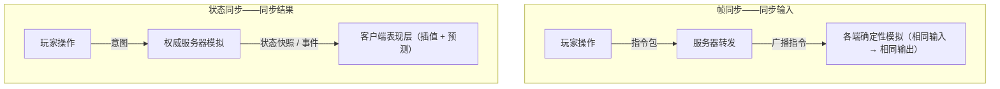
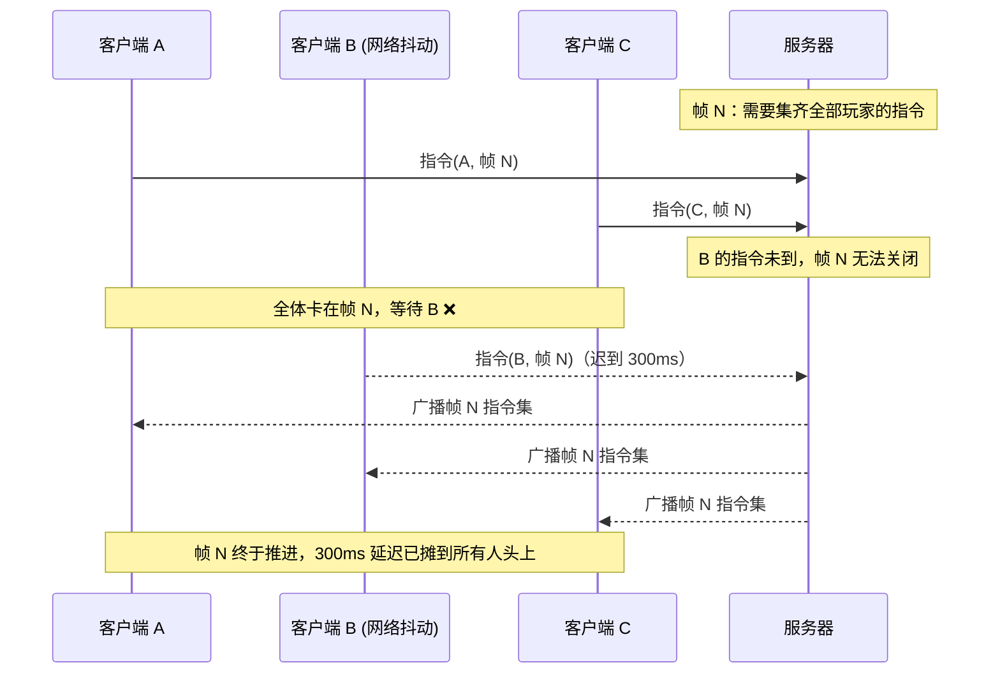
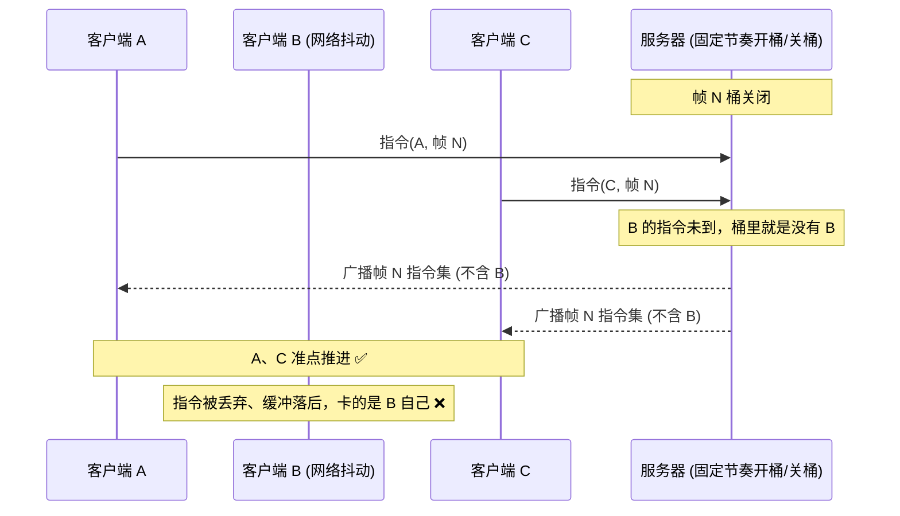
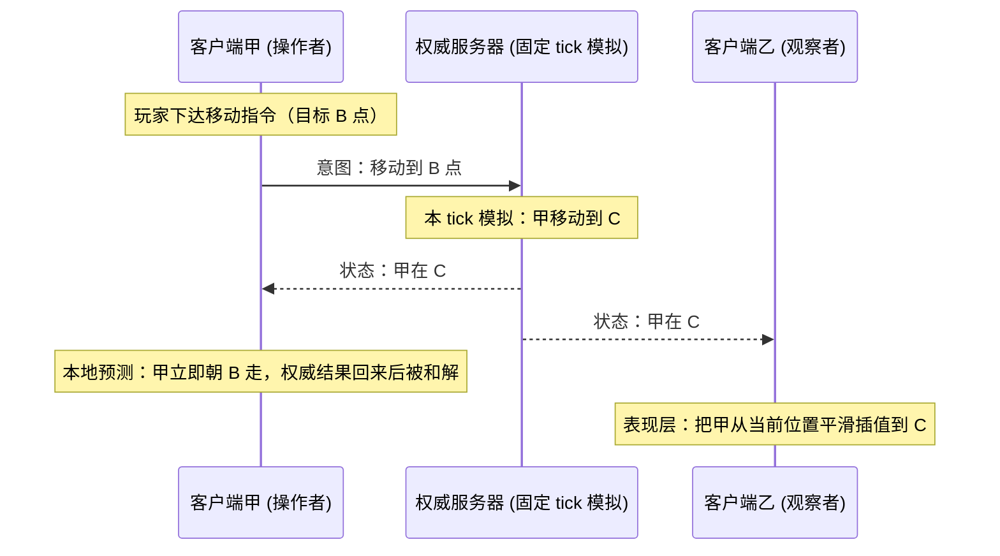
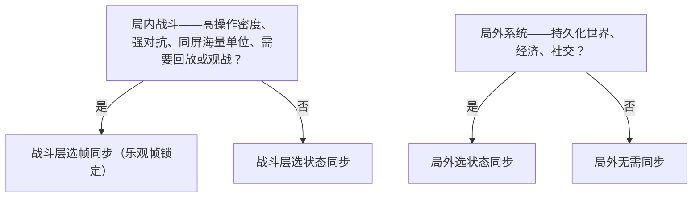

# 帧同步和状态同步

多人网络游戏的第一性问题只有一个：**若干台分布在不同网络环境里的客户端，如何各自跑出"同一场对局"**。业界几十年的实践收敛出两条主路线——

- **帧同步（lockstep）**：只同步玩家的操作指令，每个客户端各自把整场战斗模拟出来；
- **状态同步（state synchronization）**：服务器算出结果，把结果状态广播给各客户端。

两条路线没有绝对优劣，只有与具体玩法、团队结构和运营目标的匹配度差异。本文梳理两种模型的原理、工程要点、衍生形态与选型逻辑。至于传输层（KCP / WebRTC / WebSocket）怎么选，那是与同步模型正交的另一个问题，展开在[《实时游戏网络协议深度对比：KCP vs WebRTC vs WebSocket》](./real-time-game-network-protocol-kcp-vs-webrtc-vs-websocket.md)，本文不涉及。

两条路线的消息流放在一起看，结构差异一目了然：



## 帧同步/锁步同步 (Lockstep Synchronization)

什么是帧同步：帧同步常被 RTS（即时战略）游戏采用。在游戏中同步的是玩家的操作指令，操作指令包含当前的帧索引。一般的流程是客户端上传操作到服务器，服务器收到后并不计算游戏行为，而是转发到所有客户端。这里最重要的概念就是 **相同的输入 + 相同的时机 = 相同的输出**。

> 术语辨析："帧同步"这个名字的来历与所指范围历来有争议，也因此有观点主张改叫"指令同步""确定性同步"。词源考据见参考资料《关于"帧同步"说法的历史由来》。

实现帧同步的流程一般是：

1. 同步随机数种子。（游戏中一般会大量使用随机数，通过同步随机数种子，可以保持随机数一致性）
2. 客户端上传操作指令。（指令包括游戏操作和当前帧索引）
3. 服务器广播所有客户端的操作。（如果没有操作，也要广播空指令来驱动游戏帧前进）

### 确定性：帧同步的生命线

"相同的输入 + 相同的时机 = 相同的输出"这句话展开来，是一长串硬性工程约束。任何一条被破坏，各端画面就会越跑越歪，而且往往是从最后几位浮点尾数开始歪，直到整场战斗彻底分叉：

- **浮点数**：不同 CPU、编译器、SIMD 指令（FMA 重结合、x87 与 SSE 的精度差异）对同一个浮点表达式可能给出不同的最后几位。跨平台对局里这是致命的。最稳妥的做法是逻辑层完全不用浮点数（下文比较表里也是这么写的）；工程上常见的折中是统一的定点数/软件浮点数学库，所有端跑同一份代码。
- **随机数**：种子同步只是第一步；所有随机数调用点的**执行顺序**也必须完全确定。工程上更稳的做法是给每个逻辑调用点配一条独立的随机流——这样日后新增一个随机调用点，不会把后面所有调用点的序列整体搬位。
- **容器与遍历顺序**：哈希容器（Go 的 `map`、C++ 的 `unordered_map` 等）的遍历序不稳定，逻辑层只能依赖数组 + 稳定遍历；一切排序必须用确定的比较器。
- **时序**：逻辑帧必须由固定频率的帧号驱动，与渲染帧彻底解耦。逻辑里禁止读墙上时钟，禁止依赖渲染帧率的东西——Unity 的 `Time.deltaTime`、`Invoke` 这类按真实秒计时的接口都在此列。多线程逻辑必须有确定的调度点。
- **引擎设施**：商用引擎的物理引擎（如 Unity 的 PhysX）、动画系统、寻路，都是为"好看"设计的，不是为"确定"设计的，不能直接进逻辑层。这就是帧同步项目往往要**自研确定性物理引擎和数学库**的原因。
- **逻辑与表现分离**：逻辑层只吃"帧号 + 指令"，跑出一个纯粹的数值世界；渲染、动画、特效、粒子全部留在表现层，按逻辑层输出的状态做插值。这样即使各端渲染帧率不同、动画有细微差异，逻辑跑出来的结果是逐位一致的。

换句话说：**帧同步把同步问题转化成了确定性问题**。网络层反而变简单了——传的只是指令包，带宽与场上实体数量无关。这也是当年 RTS 选择它的根本原因：同屏几百个单位的世界状态，2000 年前后的网络根本传不动，而指令流只有几十个字节。

### 经典 lockstep 的死穴：同步等待

上面流程的第 3 步里藏着一个致命问题：**"广播所有客户端的操作"，意味着必须先集齐所有客户端的操作**。每一帧都要等最后一个玩家的指令到齐，才能推进：



这就是经典 lockstep 的**木桶效应**：全场玩家的游戏进度，被网络最差的那个客户端锁死。一个人手机从 Wi-Fi 切到 4G，全桌一起看幻灯片。

历史上的缓解手段是**指令延迟（command delay）**：客户端发出的指令统一延迟 N 帧再生效，给网络抖动留出缓冲窗口。上古 RTS 的 P2P lockstep 就是这么做的，代价是所有人的操作天然多出 N 帧延迟，而且抖动一旦超过窗口宽度照样卡住——只要"集齐才能推进"这个结构还在，等待就只是被摊平，从未被消除。《1500 Archers on a Network》（见参考资料）对这套机制有第一手论述。

### 服务器在帧同步中的角色

在经典方案里，服务器不跑任何游戏逻辑，只是**转发器 + 记录器**——单帧成本极低，一台机器可以同时挂成百上千个房间，这是文末比较表里"服务器压力：小"的来源。

而"记录器"这个看似不起眼的身份，恰恰是帧同步最值钱的资产。服务器手里的**全量指令日志**，直接支撑了三件事：

- **战斗回放与观战**：客户端请求到操作文件再执行一遍即可——帧同步项目的回放系统几乎零成本。观战是同一份资产的另一种消费方式：观战端本质上就是一个延迟 N 秒的回放端。
- **断线重连**：下发最近一个逻辑快照 + 快照点之后的指令日志，客户端快进模拟到当前帧即可归队。回放与重连在帧同步里是同一套基础设施。
- **服务端校验**：因为指令流是全量且确定的，服务器或离线集群可以并行跑一份一模一样的确定性逻辑，定期比对各端上报的状态哈希，对不上即判定作弊。这就是比较表里"服务器可以重启跑一遍战斗"的真正含义——反外挂不是靠对客户端内存做手脚，而是靠"我能重算你的答案"。

## 乐观帧锁定 (Bucket Synchronization)

经典 lockstep 的问题不在"同步指令"，而在"**等所有人**"。乐观帧锁定的思路只有一句话：**把"什么时候推进下一帧"的权威，从全体玩家的共识，搬到服务器手里**。

"乐观"之名借自乐观并发控制（optimistic concurrency）：不等待所有参与者确认，先推进；冲突发生——也就是有指令迟到——以丢弃收场。

同一套机制在参考资料里也被称为"帧锁定同步"（《Brick & Ball》一篇用的就是这个名字）——指的都是它。

### 机制

服务器按固定 tick 开帧、关帧，每个帧对应一个**指令桶（bucket）**。核心循环只有四行：

```text
loop 每 tick（固定节奏，与任何客户端状态无关）:
    bucket := 收集本 tick 窗口内到达的全部玩家指令
    broadcast(frame_id, bucket)   # 空桶也照常广播——充当帧心跳
    frame_id += 1
```

要点：

1. 开桶、关桶的节奏完全由服务器决定，不看任何客户端的脸色；
2. 窗口期内到达的指令落入当前桶；
3. 关桶即广播桶内全部指令——**没收到谁的，桶里就没有谁**，不存在等待；
4. 迟到的指令直接丢弃，该玩家本帧视为"无操作"。

实现上还有一个关键细节：**指令落入哪个桶，由服务器收到它的那一刻决定**。客户端自报的帧号只能用来做乱序与重复校验，不能作为落桶依据——客户端的时钟与计数器从来不可信。

对应的消息时序：



### 卡顿不再传染

把两张时序图放在一起看，差别一目了然：

| 维度 | 经典 lockstep | 乐观帧锁定 |
|------|--------------|-----------|
| 帧节奏由谁决定 | 全体客户端指令集齐 | 服务器固定 tick |
| 网络抖动的波及面 | 全体玩家一起卡 | 仅高延迟玩家自己 |
| 迟到的指令 | 阻塞整场等待 | 丢弃，本帧视为无操作 |
| 服务器角色 | 转发器 | 节律权威 + 全量指令流持有者 |
| 拓扑 | 早期 P2P 全互联，或服务器转发 | 服务器中心化 |

高延迟玩家在乐观帧锁定下的遭遇是：自己的指令被整帧丢弃（"按了没反应"）、下行跟不上广播节奏（画面停摆）——**但这一切只发生在他自己的屏幕上**。在其他玩家眼里，他只是一个"站着不动、被表现层平滑插值"的实体。木桶效应被从结构上拆掉了。

由于效果全面占优，如今商业项目里说"服务器帧同步"，基本默认就是这个形态。原教旨的"集齐再走"，除了格斗游戏的回滚网络（见下文衍生形态）之外，已经很少被原样使用。

### 客户端侧的配套

节奏交给服务器之后，客户端侧还有三件事要做：

- **尽早投递**：指令在产生的瞬间立即发出，而不是攒批到帧末——桶的窗口就这么宽，晚发一毫秒就多一分被丢的风险；
- **抖动缓冲（jitter buffer）**：对抗下行的到达抖动，按固定帧间节奏喂给逻辑层；
- **表现层插值**：逻辑帧率通常只有渲染帧率的零头，表现层负责把离散的逻辑状态插值成连续的动画。

### 代价与边界

- **丢包即丢操作**：指令一旦迟到就是永久丢失，弱网玩家的体验是断崖式的。玩法设计上必须对"丢一帧操作"有容错——角色本帧不动，而不是进入错误状态。
- **确定性要求一点没少**：只要还叫帧同步，浮点数、随机数、遍历序、引擎设施的全部约束原样有效。乐观帧锁定只改了节奏，没改本质。
- **节奏权威不等于免疫卡顿**：服务器解决了"等齐"，解决不了玩家自己的下行带宽不足。落后过多的客户端只能快进追赶，或走快照重同步——而这又回到了"快照 + 指令日志"那套基础设施。

## 状态同步 (State Synchronization)

什么是状态同步：同步的是游戏中的各种状态。一般的流程是客户端上传操作到服务器，服务器收到后计算游戏行为的结果，然后以广播的方式下发游戏中各种状态，客户端收到状态后再根据状态显示内容。

状态同步其实是一种不严谨的同步。它的设计哲学是：不同玩家屏幕上的表现是否一致，并不是重要指标，**只要每次操作的结果相同即可**。所以状态同步对网络延迟的要求并不高：像玩 RPG 游戏，200-300ms 的延迟也可以接受。反过来，RTS 这类帧同步玩法的游戏里，50ms 的延迟也会很受伤——你的指令赶不上桶，等来的就是整帧丢弃。

### 权威服务器模型

状态同步的正式学名是**权威服务器（authoritative server）模型**：服务器持有唯一的游戏状态，客户端手里的状态只是它的一份过期投影。上行的是**意图**（我想移动到 B 点），下行的是**结果**（你现在在 C 点）。全部游戏规则都跑在服务器上——这是文末比较表里"服务器压力：大""安全性：高"两行的共同来源。

还有一件事只有这个结构给得了：**世界可以在玩家下线后继续存在**。所以不只是回合制——所有 MMORPG、SLG、以及一切带持久化经济与社交系统的游戏，事实上只有状态同步这一种现实选择。

### 表现层三大件：插值、预测、延迟补偿

举个移动的例子：在状态同步里，客户端甲上的玩家操作要求从 A 点移动到 B 点，但在客户端乙上，甲对象先从 A 移动到 C，再从 C 平滑地滑向 B——因为乙收到甲的移动状态时，已经过了一个网络延迟。表现层的职责，就是把这种"迟到的真相"在视觉上抹平。把这个过程画成时序：



三大件各自的职责：

- **远端实体——插值（interpolation）与航位推测（dead reckoning）**：在两份先后到达的权威状态之间做插值（上面 A→C→B 的视觉路径就是它），或按上一份状态里的速度/朝向外推，赌下一份状态的位置，新状态到达后修正回真实值。文末比较表里"网络卡顿的表现：瞬移、回位"之所以能被驯化成"平滑滑动"，靠的就是这一层。业界标准做法是维护一段约 100ms 的插值缓冲——Source 引擎的 `cl_interp` 参数就是它——用一小段固定延迟，换掉绝大多数到达抖动。
- **本地实体——客户端预测（client-side prediction）与服务器和解（server reconciliation）**：本地操作先在客户端立即执行，给出零延迟的手感；服务器的权威结果回来后，若与预测不符，客户端回滚并用权威状态重新模拟。你动如脱兔，代价是偶尔被服务器"拉回"一下。
- **命中判定——延迟补偿（lag compensation）**：服务器为每个客户端保留一小段历史状态环，判定射击命中时，回溯到**开枪者所看到的那个时刻**的世界快照再判。它解决的是"高延迟下我明明打中了"的体验问题，也是各类透视/自瞄外挂最爱的搭车机制。

这三大件的配图版逐步拆解，见 Gabriel Gambetta 的 Fast-Paced Multiplayer 系列（参考资料），本文不展开数学。

顺带解释一个行业现象：国产 RPG 的技能特效一般做得比较绚丽（大），攻击的时候给人"击中了"的感觉；放技能之前一般有一段动画前摇，与此同时攻击请求已经提交给服务器——等服务器结果返回时，动画刚好播放完毕，之后呈现统一的伤害与结算效果。**前摇本质上是在人为制造一段"可感知的延迟预算"，把网络往返藏进演出里。**状态同步的 MMO 之所以在两百毫秒级延迟下还"玩得起来"，一半靠插值预测这些技术，另一半靠的就是这种演出层面的延迟包装。

### 流量：状态同步的原罪

帧同步的带宽只与玩家数和操作频率相关；状态同步的带宽与**兴趣区域内的实体数 × 单实体状态体积 × 广播频率**正相关，同屏实体一多，流量立刻爆炸。于是状态同步的工程，有一大部分都在跟流量作战：

- **AOI（Area of Interest，兴趣区域）**：只把玩家视野/交互范围内的实体同步给他，格子划分（九宫格）是最经典的实现；
- **增量同步**：只下发发生变化的字段（脏标记），而非完整实体快照；
- **事件化**：能表达为"发生了什么事"的（受击、死亡、拾取），走事件而不走快照。

这也是文末比较表里"流量：相对高"的来源。至于"回放：记录文件大"——状态同步的回放要么录制状态序列（体积大），要么在服务器上重跑一遍完整的权威模拟（成本高）；而帧同步只需要那份几 KB 的指令日志。

### 实测：一台 28 核机器上的千人国战

下面这组数字来自笔者一套传奇类 ARPG 服务端（自研引擎，权威服务器 + tile AOI + enter/leave 增量事件——即上文"AOI + 事件化"路线的全家桶）的千人同屏压测。环境：28 核单机、Release 构建、loopback；负载为市面玩法口径（移动/攻击/施法混合）；形态为全互见最坏情况——全部 N 个 bot 挤进同一个 25×25 视口。先交代两条口径：其一，压测端（Python/Go）在超过约 160 万帧/s 后自身解析排队、RTT 读数失真，故高负载档的延迟列不作数，帧率与 CPU 以服务端侧采样为准；其二，同一二进制同一配置在宿主机快/慢态间读数可波动 2~4 倍，以下取快态口径。

全互见形态下，稳态扇出的实测：

| N（全互见） | 人均广播帧/s | 全场扇出 | 带宽 | 服务端 CPU（均值） | RTT p50 |
|---:|---:|---:|---:|---:|---:|
| 1000 | ~1（合成负载，匀速移动） | 56.3 万帧/s | 107 Mbps | 0.79 核 | 87.8ms |
| 1000 | ~2.2（玩法混合负载） | 160 万帧/s | 303 Mbps | 1.9 核 | 98ms |

值得先说结论：服务端进程全程零崩溃、零掉线、优雅退化，160 万帧/s 也只烧掉 28 核里的约 2 核。真正的墙有三面，全在别处：

1. **串行管线天花板**。场景状态与脚本引擎的串行约束把出包上限钉在约 1.5~2M 帧/s、约 2 核——与 N 无关。而全互见的需求曲线是 N × 人均帧率 × N，两者相交于 **N ≈ 800~900**：这就是该架构下 p50<100ms 的可玩上限。N=1000 时 p99 已到 0.8s，N≥1500 进入秒级延迟。
2. **入场即风暴，且撞协议闸门**。入场风暴含 O(N²) 的 actor_enter 广播，1000 人入场实测耗时 122s。更硬的是闸门：进图 ack 单帧携带视口内全部 actor 的初始状态（约 40B/人），协议帧长上限 64KB，在视口约 1600 人时溢出——2000 人全互见压测里 281 个入场直接失败。注意这个 ack 本质上就是文末比较表"断线重连"一行所说"全量状态重新下发，代价高"在入场时刻的具体形状。
3. **每客户端接收速率**。全互见时每个客户端要收 N × 人均帧率条消息每秒（N=1000 即 2200 条/s）。压测端先于服务端饱和；真实客户端还要渲染，更不可能——市面客户端的可见渲染上限一般就在 200~400 人。

拆墙流水线——每一层手段换来的人数上限，以及下一面墙在哪：

| 层级 | 攒齐的手段 | 同屏可见 V | 战场总人数 N | 先撞的墙 |
|---|---|---|---|---|
| L0 现状 | — | 全互见 | ~900 | 广播管线（1.5~2M 帧/s） |
| L1 +分页进图 | 入场闸门移除 | 全互见 | 仍 ~900 | 同上（分页不降稳态成本） |
| L2 +摊开战场 | 密度换人数（V=300） | ~300 | ~2600 | 管线（N×V ≤ ~80 万帧/s） |
| L3 +移动合包（10 合 1） | 管线等效 ×5~8，客户端消息数 ÷10 | ~300 | 1.5 万~2 万 | 每客户端渲染与带宽 |
| L4 +网关横向扩 | 扇出复制移到网关层 | ~300（客户端裁剪上限） | 数万（每台网关 +2000~4000） | 单场景单线程 |

L0/L1 为实测；L2 起是按实测单帧成本的外推，待后续轮校准。这个阶梯本身就是文末比较表"流量：相对高"一行在真实机器上的形状：AOI 与摊开把指数从 N² 砍到 N×V，合包与网关把常数压下去，但没有任何一层把乘法变成加法。

已落地两刀的实测效果：

- **移动合包**：100ms 窗口内的移动事件合并为一帧下发（窗口延迟由客户端插值吸收——传奇 walk 约 600ms/格，≤100ms 玩家不可感知）。实测客户端消息率从 2200 条/s 降到约 30 帧/s（÷10），服务端每帧成本被窗口内事件摊薄，管线等效 ×5~8。注意**字节量不变**——合包降的是消息数与序列化调用次数，不是带宽；带宽墙按设计移到网关扇出层（网关对同一 payload 向多连接做零序列化复制，横向扩每台 +2000~4000 人）。
- **兴趣裁剪**：单桶单窗口 400 条上限的无偏采样（远端单位随时间必然被刷新，不是永久剔除）。实测 N=1000 war 档交付体量减半、每客户端条数从 4400+ 降到约 1600，叠加裁剪后多轮复测 p50 落在 53~60ms。
- **信息量下限**：摊开形态（4000 人、4.2 人/格）下，每客户端视口内的更新条数由**密度 × 视野 × 移动率**直接决定，实测天然达数千条/s。AOI 精确过滤后的服务端已按这个下限交付（零崩溃、个位数核），但"下限"的含义是：**任何服务端侧优化到此为止**。再往下只剩策略项——top-K 裁剪、缩视野、分线联邦；而真实客户端的渲染在可见几百人处先于一切撞墙。市面上的"万人国战"，真实构成都是同屏几百 + 分线/分实例制造的幻觉。

顺带一条来自网关隧道档复测的教训：三档传输模式里 p50 最低的那档（449ms）是靠主动丢帧买来的——每 60s 窗口丢弃 9~20 万条下行帧，客户端的位置纠正量随之上升一个数量级。**延迟账必须和一致性账一起报**，只看任何一列都会选错方案。

同一台引擎里还有第二个状态同步的活样本：一个对局制（MOBA 形态）的切片，不叠事件增量，走的是 Quake/Source 谱系的**周期快照 + per-viewer AOI 过滤 + 客户端插值**，逻辑帧率默认 20Hz；对局模拟按对局隔离进 worker 池，输入经有界 mailbox 投递（溢出丢弃并计数），worker 按绝对 deadline 自驱、固定 dt、落后即跳帧对齐、帧号单调不回退，实测两对局并发时各自维持满速 20Hz 互不干扰。把它和乐观帧锁定并排放着看，会得到本文最值得记住的一个正交分解：**节律与内容是两根独立的轴**——节律轴上（谁定 tick、迟到怎么办）两条路线殊途同归地收敛到"服务器定节奏、迟到即丢、时间线单调"，而内容轴上（桶里装的是指令还是快照）才是帧同步与状态同步真正的分界。同时它也说明：大世界走事件增量、小对局走周期快照，两种状态同步子形态在同一引擎里并存——选型光谱比二分法宽得多。

最后修正一个直觉。文末比较表里"服务器压力：大"一行，实测里主要不表现为算力（160 万帧/s 仅约 2 核），而是表现为协议与策略层的工程量——合包、分页、裁剪、网关扇出、分线编排，每一刀都是协议设计活。这正是"工程重心：服务器侧"那一行的本意：状态同步的成本大头从来不在 CPU，在协议与编排工程的漫长清单上。

## 衍生形态

两条主路线之外，还有一批在各自生态位上成熟的衍生技术，值得知道名字与归属：

- **回滚网络（rollback networking，代表实现 GGPO）**：P2P lockstep 的变体。本地先假设远端玩家"这几帧没动"并继续推进；远端真实输入到达后若与假设不符，回滚到分叉点、带上新输入重新模拟。它把"等待"换成了"赌你没动"，赌错就付一次回滚重模拟的代价，把本地输入延迟压到理论最小值。现代格斗游戏的网络代码几乎清一色基于它。注意它与乐观帧锁定是**两条不同的演进路线**：一个去中心化赌预测，一个中心化定节奏。
- **延迟补偿（lag compensation）**：状态同步家族，上文已述——Valve 系 FPS 的标配。
- **航位推测（dead reckoning）**：状态同步最早期的远端实体外推技术，源自军用分布式仿真标准 DIS，后来与插值合并成现代的"插值到权威状态"。
- **混合形态**：现实项目极少纯血。最常见的组合是**局内战斗走帧同步（乐观帧锁定）、局外大厅/经济/社交走状态同步**——局内要操作密度、要回放观战，局外要持久化、要反外挂，各取所长。

同步技术三十年来的完整谱系（DR→lockstep→权威服务器→回滚），《细谈网络同步在游戏历史中的发展变化》上下两篇（见参考资料）梳理得比本文细得多，推荐整篇读完。

## 状态同步和帧同步的比较

| 维度 | 状态同步 | 帧同步 |
|------|------|------|
| 流量 | 相对高 | 相对低 |
| 回放 | 记录文件大 | 记录文件小 |
| 安全性 | 服务器实现逻辑，安全性高 | 逻辑在客户端，反外挂压力大、无法避免开图挂 |
| 服务器压力 | 大 | 小 |
| 战斗校验 | 协议加密、内存混淆、误差校验，无法彻底解决 | 服务器持有全量指令日志，可重放整场战斗比对 |
| 网络卡顿的表现 | 瞬移、回位、莫名掉血 | 战斗卡顿 |
| 断线重连 | 全量状态重新下发，代价高 | 快照 + 指令日志追帧，代价低 |
| 实现 | 权威服务器，客户端需要做插值处理 | 客户端按照单机方式开发，保证逻辑层和表现层分离。逻辑层不要用到浮点数，不要用不确定顺序的逻辑结构。物理引擎和浮点数计算不能使用 Unity 自带的 |
| 工程重心 | 服务器侧：游戏逻辑全量实现、AOI 与性能工程、防刷防作弊 | 客户端侧：确定性工程——定点数学、确定性物理、逻辑与表现分离 |

## 如何选型

选型不是选信仰，是匹配玩法属性。下面这两个问题互相独立，分开回答，答案往往自己就浮出来了：



几个强信号：

- **倒向帧同步（乐观帧锁定）的信号**：高操作密度、强对抗、同屏实体数量巨大（指令流带宽不随实体数增长）、需要回放/观战/战报系统、单局时长短、世界不需要局外持久化。
- **倒向状态同步的信号**：世界持久化、经济与社交系统、反外挂优先级压倒一切、延迟容忍度高（百毫秒级可玩）、长线运营需要随时热修逻辑。
- **默认答案常常是混合**：局内帧同步 + 局外状态同步。绝大多数长线运营的对抗类项目，最后都长成了这个形状。

同步模型定了之后，传输层（KCP / WebRTC / WebSocket）怎么选是另一个正交问题，展开见[《实时游戏网络协议深度对比：KCP vs WebRTC vs WebSocket》](./real-time-game-network-protocol-kcp-vs-webrtc-vs-websocket.md)。

## 总结

- **帧同步把同步问题转化成了确定性问题**：网络只传指令，带宽与实体数量无关，代价是客户端背起确定性的全部工程债。它的可行形态是乐观帧锁定——服务器定节奏、迟到即丢，木桶效应被从结构上拆除。
- **状态同步把同步问题转化成了服务器问题**：权威服务器持有唯一的世界状态，客户端用插值、预测、延迟补偿三件套掩盖延迟。代价是流量与服务器负载，换来的是安全性、持久化的世界、以及随时热修逻辑的能力。
- **现实项目大多是混合体**：局内帧同步，局外状态同步。选型真正该问的不是"哪个更好"，而是"我的哪一层，要的是什么"。

## 参考资料

- [lockstep 网络游戏同步方案](https://blog.codingnow.com/2018/08/lockstep.html)
- [帧同步游戏开发基础指南](https://mp.weixin.qq.com/s/ambS-XTKV_RllXG3F5FjcA)
- [关于 “帧同步”说法的历史由来](https://zhuanlan.zhihu.com/p/165293116)
- [《Unity3D高级编程之进阶主程》第六章，网络层(六) - 网络同步解决方案](http://www.luzexi.com/2019/07/14/Unity3D%E9%AB%98%E7%BA%A7%E7%BC%96%E7%A8%8B%E4%B9%8B%E8%BF%9B%E9%98%B6%E4%B8%BB%E7%A8%88-%E7%BD%91%E7%BB%9C%E5%B1%826)
- [Lockstep protocol](https://en.wikipedia.org/wiki/Lockstep_protocol)
- [细谈网络同步在游戏历史中的发展变化（上）](https://zhuanlan.zhihu.com/p/130702310)
- [细谈网络同步在游戏历史中的发展变化（下）](https://zhuanlan.zhihu.com/p/336869551)
- [《Brick & Ball》开发总结（一）——帧锁定同步](https://musoucrow.github.io/2018/03/09/bnb_1/)
- [[Unity Mirror] State Synchronization（状态同步）](https://blog.csdn.net/u013716859/article/details/123317761)
- [1500 Archers on a Network — Mark Terrano & Paul Bettner, GDC 2001（Age of Empires 的 P2P lockstep 与指令延迟机制的一手论述）](https://www.gamasutra.com/view/feature/131503/1500_archers_on_a_network_what_.php)
- [What Every Programmer Needs To Know About Game Networking — Glenn Fiedler（DR→lockstep→权威服务器→预测回滚的经典综述）](https://gafferongames.com/post/what_every_programmer_needs_to_know_about_game_networking/)
- [Fast-Paced Multiplayer 系列 — Gabriel Gambetta（客户端预测、插值、延迟补偿的配图教程）](https://www.gabrielgambetta.com/client-server-architecture.html)
